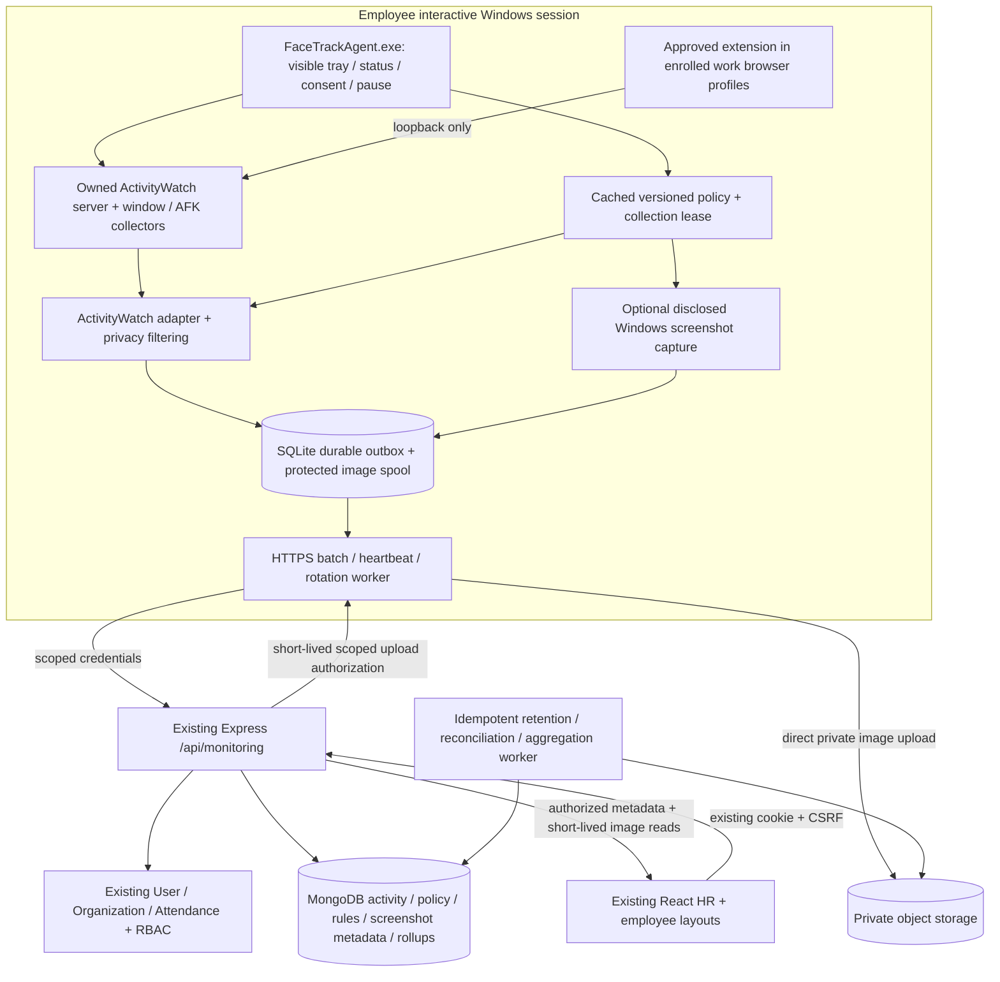

# FaceTrack monitoring — proposed integration architecture

Baseline: `4364230`. Audit started 2026-11-21. Phase 3 design only: **no implementation is authorized by this document**. VERIFIED existing facts are supported by [FACETRACK_EXISTING_SYSTEM_AUDIT.md](FACETRACK_EXISTING_SYSTEM_AUDIT.md); upstream evidence is in [ACTIVITYWATCH_FEASIBILITY_AUDIT.md](ACTIVITYWATCH_FEASIBILITY_AUDIT.md). All new modules, endpoints, configuration, estimates and operating thresholds below are **PROPOSED / INFERRED**, not existing capabilities or measured results.

## 1. Decision and preservation boundary

Recommend **Option B: one signed FaceTrack Windows installer and a visible .NET desktop agent supervising selected ActivityWatch collectors**. Retain the existing Express/MongoDB identity and monitoring API, extend its contracts carefully, and reuse React's current role layouts/design system. Do not replace the attendance application or introduce a second employee/organization database.

The product promise should be **one FaceTrack installation and one employee-facing application**. `FaceTrackSetup.exe` may install `FaceTrackAgent.exe`, collector executables, native/runtime files and notices. That is not the same as promising that the installed product is literally one dependency-free binary or that browsers need no integration.

Keep the current Node agent usable until the native replacement passes acceptance and an explicit cutover is approved. Do not silently import personal ActivityWatch records. Existing face recognition, enrollment, office/WFH decisions, attendance policy and historical attendance remain unchanged.

## 2. Options comparison

Relative effort/resource judgments are engineering estimates. CPU/RAM figures, final installer size and all-in operating cost require measurement; none is claimed proven.

| Dimension | A: ActivityWatch + current/custom sync agent | B: bundled collectors + FaceTrack desktop supervisor | C: custom .NET collectors |
| --- | --- | --- | --- |
| Effort | Lowest initial; substantial hardening still needed | Medium–high: desktop, lifecycle, queue, installer and existing API hardening | Highest collection/edge-case verification effort |
| Reuse | Current Node adapter/API/UI | Existing AW collection behavior and FaceTrack API/UI/data mappings | API/UI retained; collection behavior rewritten |
| Reliability | Manual prerequisites/startup; current restart gaps | Controlled versions, owned child processes, durable queue; must be validated | Fewer AW processes, but collection correctness/maintenance owned fully |
| Windows compatibility | Depends on installed AW and Node | Pin tested Windows/architecture and bundled release matrix | Pin .NET/Windows APIs and implement all edge cases |
| Foreground tracking | Existing watcher behavior | Same watcher foundation with supervised lifecycle | Win32 foreground/process APIs; UWP/elevation/RDP handling must be built |
| Browser URLs | Extension still required for supported reliable coverage | Same; installer can guide work-profile integration, not bypass it | Same browser limitation; writing a collector does not remove it |
| Screenshots | Separate component needed | Native desktop capture component integrated with policy | Native component also needed |
| Installer | Current ZIP is inadequate | One installer, multiple internal files/processes | Potentially simpler distribution, but runtimes/native files may remain |
| Resource use | AW + Node; actual baseline unmeasured | AW + .NET shell; avoid duplicated Qt/Node UI runtimes where possible | Potentially smaller process count; not a measured performance claim |
| Licensing | Existing local installs do not eliminate future redistribution duties | Pinned AW/transitive SBOM and notices; assess excluding Qt launcher | Own collector licensing plus .NET/native/third-party dependencies |
| Security | Plain local token file; no managed collector boundary | Protected credentials, dedicated profile, policy enforcement, signed updates | Similar controls required; fewer collector dependencies but more privileged code |
| Maintenance | JS familiarity; manual endpoint support | Upstream compatibility plus Windows packaging ownership | Full Windows collector and browser integration ownership |
| Deployment cost | Lowest packaging effort, higher manual support | Initial packaging/signing/support cost; same cloud workloads | More engineering cost; no demonstrated cloud-cost advantage |

**Decision rationale:** A already fails the manager's installation requirement. C would discard functioning collection behavior before proving a need. B improves the employee experience while preserving the current identity/reporting investment. Choose C only if a pinned AW distribution fails licensing, footprint, compatibility or reliability gates; evaluate that with a separate proof before rewriting collectors.

## 3. Desktop framework comparison

| Candidate | Fit with this repository and trade-off |
| --- | --- |
| .NET Windows desktop (WPF/WinForms; choose one during prototype) | Adds a new C# project, but fits Windows-first tray/status, process supervision, OS-protected storage and capture interop. Keep it a small native control surface, not a duplicate attendance client. Recommended. |
| Tauri | React UI familiarity and sidecars are attractive, but adds Rust, Windows native build tooling and WebView2 requirements. Capturing screens and protecting credentials still need native integration. A feasible alternative if desktop cross-platform scope becomes a firm priority. |
| Electron | Reuses JavaScript and could bundle the current agent, but adds a Chromium/Node distribution and associated update/security workload. No repository Electron project exists. Do not assert a measured footprint disadvantage without testing. |

.NET supports self-contained/single-file publishing, with native-library extraction and platform/runtime constraints; that does not incorporate AW executables into one live process. Tauri supports Windows installers but requires its own Windows build/runtime prerequisites. [Microsoft single-file deployment](https://learn.microsoft.com/en-us/dotnet/core/deploying/single-file/overview), [Tauri prerequisites](https://v2.tauri.app/start/prerequisites/), [Tauri Windows installers](https://v2.tauri.app/distribute/windows-installer/).

## 4. Proposed logical architecture

No local collector port is publicly exposed. Desktop credentials do not become browser session credentials. Screenshot bytes do not pass through MongoDB documents or become permanently public URLs.

## 5. Desktop lifecycle and collection boundary

1. Install a signed per-user application or an approved managed-machine package. Choose install scope, supported Windows releases, x64/ARM64 and update channel explicitly. Do not install an interactive collector as a Session-0 service and assume it can observe the signed-in desktop.
2. Present FaceTrack identity, collection disclosure and browser/screenshot availability. Pair against an allowlisted configured FaceTrack origin using the existing one-use-code concept. A device must never accept an organization/employee mapping merely supplied by the client.
3. Protect the scoped credential using Windows current-user protection and restrictive ACLs. A separate consent epoch identifies authorized collection intervals. Use a named AW profile/configuration and dedicated loopback port where supported by the pinned release. Handle existing personal AW installations explicitly; do not kill/adopt unrelated processes.
4. Supervise only owned collectors: single-instance lock, child ownership, readiness checks, bounded restart backoff, crash/port-collision diagnostics, and health reporting. Verify image/package hashes before execution. Keep a visible user-facing monitoring state even when child processes have no console.
5. Persist normalized observations before advancing the local read checkpoint. Synchronize only within the permitted policy/consent boundary; preserve pending authorized events across application restart. Starting a process must not create a new consent epoch automatically.
6. On pause, stop new FaceTrack capture/queueing for the paused interval and apply explicit collector-storage policy. Distinguish local ActivityWatch logging from cloud uploads in the UI. Separate employee pause, administrator hold and revoked state: an agent must not override an administrator hold, and an administrator resume must not override an employee privacy pause.
7. On uninstall/exit/update, stop owned processes, safely persist pending state, and execute the approved revocation/deletion policy. Offline uninstall must give a clear server-revocation path. Signed update manifests, rollback protection and queue schema migration must be tested before automated updates.

Windows `ProtectedData` supplies a relevant OS protection mechanism; it does not protect against malware already acting as the same user. SQLite transactions can bind outbox rows and checkpoints atomically. [ProtectedData](https://learn.microsoft.com/en-us/dotnet/api/system.security.cryptography.protecteddata), [SQLite transactions](https://learn.microsoft.com/en-us/dotnet/standard/data/sqlite/transactions).

## 6. Identity, policy and API extensions

Preserve existing paths and request/error conventions: `createAuthenticate`, `requireRole`, `validate`, `asyncHandler`, `ApiError` and `writeAudit`. Keep old prototype protocol support during an explicit migration window.

### Proposed persistence additions

| Model | Proposed responsibility |
| --- | --- |
| Existing `MonitoringDevice` | Add credential generations/rotation ID, capabilities, agent/collector versions, separate pause actors, consent/policy version and lease/health metadata; retain employee/org ownership |
| Existing `ActivityEvent` | Add source epoch/version and optional approved URL/title fields only after policy approval; preserve a stable unique source identity and expiration |
| New `MonitoringPolicy` | Unique organization reference; versioned collection scope, schedule/attendance coupling, consent version, retention, exclusions, screenshot controls and limits |
| New `ProductivityRule` | Organization + version + app/domain/path matcher + classification + precedence; neutral fallback |
| New `Screenshot` | Organization, employee, device, capture ID/time, policy/consent revision, private object key, hash/size/dimensions, upload state and expiresAt; no image binary |
| New `ActivityDailySummary` | Organization/employee/local-date/timezone + rule revision + bounded rollup metrics; rebuildable from retained source data |

### Proposed endpoint capabilities, not existing routes

| Path under `/api/monitoring` | Design |
| --- | --- |
| Existing `/devices`, `/enroll`, `/agent/events`, `/agent/heartbeat` | Extend versioned contracts; always derive employee/org from session or credential; reject unsupported capability/policy versions |
| `POST /agent/credentials/rotate` | Device-authenticated, idempotent rotation with proof of new-key ownership and bounded overlap; revocation wins over rotation |
| `GET /policy`, `PUT /policy` | Scoped reads and HR policy management with audit/versioning; employee receives only applicable disclosure/collection settings |
| `GET,POST /rules`, `PATCH,DELETE /rules/:id` | HR scoped rule lifecycle; bound matcher complexity and record version |
| `POST /agent/screenshots/authorize` | Validate device/capture authorization, policy lease, timestamp, size and capture ID; issue a short-lived private upload authorization |
| `POST /agent/screenshots/:id/complete` | Idempotently verify stored object, checksum/content/size; mark ready only after validation |
| `GET /screenshots`, `GET /screenshots/:id/content` | Explicit HR/employee permissions, organization checks, expiry and read audit; pagination and short-lived private reads |
| Existing `/report`, plus `GET /timeline` | Daily/weekly aggregates and paginated interval timeline; every predicate includes organization and employee permissions |

The current opaque credential can evolve without embedding FaceTrack JWT signing secrets on devices. A concrete rotation design is: generate/persist a new random secret locally first; submit its hash with a rotation ID under the current credential; server atomically stores the new generation and brief old-key overlap; repeat requests with the same rotation ID/hash are safe. The client probes/acknowledges the new generation and retires the old local key only after success. Lost replies, replayed rotation IDs, concurrent rotations and revoked devices require tests. No raw replacement token needs to be logged or persisted in plaintext on the server.

Use a broad unauthenticated IP throttle followed by authenticated device/tenant quotas; share limiter state when the API scales. Combining heartbeat, status and policy response reduces round trips. Size budgets must include common-NAT traffic and outage catch-up. Batch IDs/event IDs are not authorization tokens.

## 7. Durable offline and retry protocol

The existing source-key upsert is reusable, but a cursor alone is not an event queue. Proposed desktop SQLite tables: source checkpoints, queued events, upload batches/acknowledgments, policy/consent epochs and screenshot spool metadata. Encrypt sensitive payloads/spool files with a key protected to the employee OS account.

Read a settled source interval; privacy-filter and assign stable source IDs; atomically persist its outbox rows and checkpoint. Retrying sends identical persisted identities rather than regenerating segments from a moving clock. ACK means durable server acceptance or a terminal per-event policy rejection; never advance a whole batch on an ambiguous partial response. Unique indexes must exist before ingestion readiness. Server upserts and any retention/read-model work must tolerate replay.

Use bounded exponential backoff with jitter and Retry-After handling; stop on revoked/disabled credentials rather than endlessly retrying. Maintain explicit maximum queue age/disk quota and visible gap/error states for disk-full, corruption, stale policy or expired data. Proposed starting limits: text queue <=72 hours and screenshot queue <=24 hours with an independently approved disk cap; these are policy candidates, not current behavior.

Distinguish outage from deliberate pause: never backfill an excluded paused interval. Offline screenshot capture should stop when its short-lived authorization lease expires (propose <=2 minutes); queued captures already authorized may upload only if current server policy still permits them. A no-network state does not authorize unlimited covert capture. Text monitoring's offline window and attendance coupling require a separate approved rule.

Source timestamps are UTC; store server receipt time and clock-skew observations. Handle late AFK heartbeat changes, timezone/daylight-saving boundaries, restored/reinstalled collector databases, source ID resets and multiple browsers. Keep clock/collector failures as unknown gaps instead of assigning invented work time.

## 8. Reports and productivity semantics

Compute observed app intervals, non-AFK intervals, approved collection windows and (if required) actual checked-in attendance intervals separately. Authorized active time is an interval intersection; employee totals across devices use a union, not a sum. App/browser allocation uses an explicit primary-device/conflict rule; unresolved overlapping classifications should be reported as unknown/overlap rather than double-counted.

Example: Code.exe is observed for ten minutes but non-AFK overlaps only seven; a productive-app rule can classify at most those seven authorized active minutes. Do not add a concurrent browser interval as extra employee working time. Browser rules apply only when the authorized browser context corresponds to the foreground activity; otherwise preserve unknown context.

Rules are tenant-owned and versioned. Prefer bounded exact/domain/glob matchers; domain suffix matching must respect boundaries. A browser domain/path rule can override the browser EXE rule; excluded/private scope wins over all classification. No match is neutral. Keep classifications reproducible by rule revision; retrospective reclassification is explicit and audited. These are policy labels, not evidence of employee intent.

Use organization timezone for calendar-day/week summaries; store UTC source intervals. Precompute rebuildable daily rollups once volume justifies them. Keep full timeline pagination separate from top-N charts. Show unknown time, overlap, last upload and collector failures alongside totals. Do not alter attendance hours/payroll based on these observations.

## 9. Screenshot subsystem and permissions

Implement screen capture separately from `FaceEvidence`. Default it off and require a distinct employee disclosure/consent revision and organization policy. A visible status indicator remains present. The interactive capture API must handle denied permissions, selected displays, resolution/HDR changes, multi-monitor setups, lock/sleep/RDP and protected content. Apply exclusions/redaction before local persistence; if safety cannot be established, drop the capture and record a reason.

Create a deterministic capture UUID and local hash before uploading. The API generates an organization/device-scoped private object key, never accepts an arbitrary URL to fetch, limits content/type/size and issues an expiring upload grant. Direct object uploads avoid buffering desktop images through MongoDB or a public frontend. Finalize verifies the owned object before its metadata becomes visible. Replays cannot create duplicate gallery entries.

Require explicit screenshot-view permission in addition to tenant membership; define employee self-view. Audit list/view/download as approved. Issue short-lived authorized reads or proxy them through a checked endpoint; do not store permanent public URLs in the UI. Avoid caching sensitive images in public CDNs or persistent service-worker caches.

MongoDB TTL can expire metadata but cannot delete object-storage bytes. Configure object lifecycle and an idempotent deletion/reconciliation worker, including orphaned/unfinished uploads and employee deletion. Deny expired reads immediately even while physical deletion is pending. Keep independently recoverable cleanup manifests so expired metadata does not erase the only object key. Retention changes must address existing objects explicitly.

## 10. React and realtime integration

Extend `MonitoringPage` and existing `Card`, `Badge`, `Button`, `PageHeader`, layouts and forest/cream CSS variables. Keep the attendance dashboards and biometric controls intact. Split complex monitoring features into scoped components rather than continuing a single large JSX page.

HR: employee/device overview, software connectivity distinct from employee AFK, recent foreground observation, upload freshness, active/idle/unknown breakdown, classification, daily/weekly reports, app/site usage, paginated timeline, authorized screenshot gallery and policy/rules controls. Employee: own device/status/history, disclosure revisions, approved pause, connection diagnostics and optional screenshot self-view. Show unsupported URL/capture states truthfully.

Existing Socket.IO server infrastructure is a reuse candidate, not a completed monitoring event path. Begin the first pilot with explicitly labeled bounded polling if that latency is accepted. For actual push, validate a supported production transport and add authenticated org/user rooms, frontend subscriptions and query invalidation. Current controllers emit to some user rooms that are not joined. A proposed cookie-authenticated endpoint can mint a short-lived, audience-bound realtime token for an external socket transport; pass it in the socket auth payload, never a URL, and revalidate membership/expiry. Broadcast identifiers/invalidation events, not raw screenshots or reusable image URLs.

## 11. Exact file-by-file implementation plan — after approval only

Create branch `feat/activitywatch-desktop-integration` after approval. The following **existing files are verified**; all named new files are **proposed and do not exist**.

### Existing files to preserve or extend

| File | Planned action |
| --- | --- |
| `server/src/models.js` | Preserve attendance/User/Organization/biometric models; add no screenshot binary field |
| `server/src/services/auth.service.js`, `middleware/auth.js`, `utils/cookies.js` | Preserve login/cookie/RBAC semantics; reuse authenticated actor; only add a separately reviewed realtime token function if selected |
| `server/src/services/attendance.service.js`, `attendance-policy.service.js`, `geofence.service.js` | Preserve decisions/calculations; expose scoped read-only work-session context to policy rather than change attendance |
| `server/src/services/enrollment.service.js`, `face-provider.service.js`, `face-evidence.service.js`, `biometric-crypto.service.js` | Preserve biometric flow and camera-evidence behavior; separate follow-up for encryption-key/transaction risks |
| `server/src/models/MonitoringDevice.js` | Versioned credentials, policy/capability metadata, separate pause ownership and lifecycle |
| `server/src/models/ActivityEvent.js` | Stable source identity/epoch, policy revision, approved browser fields and query/index additions |
| `server/src/validators/monitoring.schemas.js` | Versioned limits, URL minimization, policy/rules/screenshot/rotation request schemas |
| `server/src/services/monitoring.service.js` | Extract/harden ingestion and interval reporting; add scoped helpers while preserving existing protocol |
| `server/src/controllers/monitoring.controller.js`, `routes/monitoring.routes.js` | Add validated capabilities listed above; device/tenant limiter; audited role guards |
| `server/src/services/employee.service.js` | Extend employee deletion with an idempotent private-object cleanup request; never attempt irreversible object deletion inside an uncommitted DB transaction |
| `server/src/services/audit.service.js` | Structured actor/device read/write audit and redaction conventions |
| `server/src/sockets/setup-sockets.js` | Only after transport approval: realtime token validation, user/org rooms and revocation handling |
| `server/src/config/env.js`, `.env.example` | Validate new private storage, policy, queue/worker and retention settings without exposing credentials |
| `server/src/server.js` | Readiness/shutdown integration for approved workers; no collector processes on Render |
| `server/package.json`, root `package-lock.json` | Add only selected object-storage/job/validation dependencies; preserve user's existing manifest formatting/change |
| `client/src/pages/MonitoringPage.jsx`, `styles/monitoring.css` | Compose new scoped components; continue existing shared design |
| `client/src/pages/hr/AdminDashboardPage.jsx`, `pages/employee/EmployeeDashboardPage.jsx` | Small monitoring summary/link only; preserve attendance features |
| `client/src/pages/hr/EmployeesPage.jsx`, `app/App.jsx`, layout files | Extend existing navigation/employee drill-down, not replace routes/layouts |
| `client/src/utils/agent-download.js`, `zip.js` | Keep POC available until signed-installer rollout; then present verified release metadata/link without embedding credentials |
| `facetrack-sync-agent/index.mjs`, `activitywatch.mjs`, launchers | Preserve as compatibility adapter/test oracle; no removal without accepted migration |
| `docs/api.md`, `README.md`, `docs/activitywatch.md`, `docs/deployment.md`, `docs/security.md` | Correct stale instructions; document actual installer, policies, operational runbooks and migration |
| `vercel.json`, `client/vercel.json`, `client/src/api.js` | Preserve first-party API/auth path; change transport only with explicit tested deployment need |

### Proposed new backend/frontend files

| Proposed path | Responsibility |
| --- | --- |
| `server/src/models/MonitoringPolicy.js` | Versioned organization policy |
| `server/src/models/ProductivityRule.js` | Tenant rules and precedence |
| `server/src/models/Screenshot.js` | Private-object metadata/state/retention |
| `server/src/models/ActivityDailySummary.js` | Bounded daily rollup model |
| `server/src/services/monitoring-policy.service.js` | Effective policy, consent epoch and collection authorization |
| `server/src/services/monitoring-credentials.service.js` | Hash/version/rotation/revocation protocol |
| `server/src/services/monitoring-ingestion.service.js` | Durable acknowledgments, replay and source validation |
| `server/src/services/monitoring-reports.service.js` | Interval unions/intersections and rollups |
| `server/src/services/productivity.service.js` | Deterministic versioned classification |
| `server/src/services/screenshot.service.js` | Capture authorization, finalize, scope and read audit |
| `server/src/services/object-storage.service.js` | Private storage adapter; no arbitrary remote URL fetch |
| `server/src/jobs/monitoring-retention.job.js` | Idempotent object deletion/expiry/orphan reconciliation |
| `server/src/jobs/activity-rollup.job.js` | Rebuildable aggregation/checkpoints |
| `server/scripts/monitoring-indexes.mjs` | Explicit reviewed migration/readiness verification |
| `client/src/services/monitoringService.js` | Typed-by-schema API boundary shared by monitoring components |
| `client/src/components/monitoring/{Overview,ActivityTimeline,ScreenshotGallery,PolicyForm,ProductivityRules}.jsx` | Scoped UI components within existing app |
| `.github/workflows/monitoring-checks.yml` | Approved branch checks/builds; no automatic production screenshots or secret dumps |

### Proposed new Windows project

| Proposed path | Responsibility |
| --- | --- |
| `desktop/FaceTrackAgent/FaceTrackAgent.csproj` | Selected supported .NET Windows target, controlled dependencies |
| `desktop/FaceTrackAgent/App.xaml`, `MainWindow.xaml`, `TrayController.cs` | Visible status/connection/pause control surface |
| `desktop/FaceTrackAgent/Services/EnrollmentService.cs` | One-use device enrollment |
| `desktop/FaceTrackAgent/Services/CollectorSupervisor.cs` | Owned collector/profile/port lifecycle and health |
| `desktop/FaceTrackAgent/Services/ActivityWatchClient.cs` | Release-tested local API adapter |
| `desktop/FaceTrackAgent/Services/CredentialStore.cs` | Current-user protected secrets and ACLs |
| `desktop/FaceTrackAgent/Services/PolicyService.cs` | Effective policy, lease and consent/pause boundary |
| `desktop/FaceTrackAgent/Services/OutboxStore.cs` | Transactional checkpoints/events and protected image metadata |
| `desktop/FaceTrackAgent/Services/SyncWorker.cs` | Stable batches, ACKs, retries, heartbeat and rotation |
| `desktop/FaceTrackAgent/Services/ScreenCaptureService.cs` | Separate authorized interactive screenshot capture |
| `desktop/FaceTrackAgent/Services/PrivacyFilter.cs` | On-device exclusions/redaction before persistence |
| `desktop/FaceTrackAgent/Services/UpdateService.cs` | Signed update verification and rollback-safe application |
| `desktop/installer/FaceTrackSetup.iss` | Candidate one-install packaging/uninstall; installer technology still subject to release/license prototype |
| `desktop/collectors/manifest.json` | Pinned versions, checksums, provenance and third-party notice/source references; no unreviewed vendored binaries |
| `desktop/FaceTrackAgent.Tests/` | Native unit/integration and lifecycle tests |
| `server/tests/monitoring-integration.test.js`, `screenshot-authorization.test.js`, `productivity.test.js` | New real-service acceptance suites in isolated environments |

Implementation modules: policy/credentials first → outbox/ingestion → native visible agent + collector packaging → interval reports/classification → optional screenshots/gallery → updates/uninstall + load/operational acceptance. Review each module with its tests before expanding scope.

## 12. Test and pilot acceptance plan

Current evidence is limited to the audit's 83 passing tests and production build, local metadata inspection and source analysis. No native executable, screenshot system, live real-employee end-to-end run or 15-device performance test was performed.

| Test group | Required cases and acceptance evidence |
| --- | --- |
| Enrollment/auth | Expired/used/invalid codes, disabled employee/org, cross-tenant IDs, token expiry, rotation reply loss, revocation during upload; no credential leakage |
| Data isolation | Real isolated MongoDB/object-store tests: HR A and Employee A cannot read/write/authorize/list/delete B's events, objects, rules, devices or rollups |
| Idempotency | Same batch/event/capture repeated, out of order, partial server failure, concurrent retries; verify actual unique indexes and no double-counting |
| Collector accuracy | Test VS Code/Chrome/Explorer/another app, rapid switches, UWP/elevation, lock/sleep/RDP, browser/profile exclusions, clock changes and missing watchers |
| Offline/restart | Kill agent/server at each commit/ACK boundary; reboot; 72-hour simulated outage; disk full/corruption; preserve authorized queued events and explicit gaps without importing paused history |
| Screenshots | Permission deny/revoke, private/excluded apps, multiple displays/HDR, invalid size/type/checksum, upload replay, expired read grants, unfinalized objects and physical retention cleanup |
| Classification/reporting | AFK intersections, overlapping devices, unknown conflicts, rule precedence/versioning, organization timezone and calendar-week/DST boundaries |
| Existing attendance | Run current tests plus full invitation/enrollment/office/WFH/face/check-in/check-out/history regression against isolated DB/provider fixtures; monitoring must not grant attendance |
| Packaging | Clean/existing AW install, no preinstalled Node/.NET runtime, port conflict, standard-user rights, child crash, uninstall offline, signed update/rollback and stale/malicious manifest |

Pilot sequence: **1 consenting test employee → 5 → 15**; only after each gate passes consider 50 and multiple organizations. Proposed initial targets, to approve rather than claim achieved: online revoke/hold enforced within 60 seconds, screenshot offline lease <=2 minutes, 24-hour activity delivery recovery without silent authorized-event loss, stable queue/disk limits, bounded report latency under representative retention, and no cross-tenant access. Measure CPU/RSS for the complete process tree, queue size, upload bandwidth, API latency/errors/429s, MongoDB index/storage growth, screenshot operations/retention and update/uninstall reliability. Set numeric CPU/RAM/report-latency budgets after a baseline on representative machines; do not invent “lightweight” measurements.

## 13. Deployment and cost model

Retain Vercel frontend + Render Express deployment unless a separate hosting change is approved. Pin Node within the server's >=20.19,<25 bound, create reviewed indexes before readiness, use an isolated staging organization/bucket for acceptance, and make rollout/revocation reversible. Store screenshots in private object storage; no screenshots on ephemeral API disks. Render documents free-service sleep/ephemeral storage limitations. [Render free-service documentation](https://render.com/docs/free).

### Capacity assumptions and calculations

These are **INFERRED scenario calculations**, not measured production usage. Assume 22 workdays/month, 8 hours/day, one computer per employee and three active watcher buckets. Current agent interval is ~30 seconds. A typical cycle can make 5 cloud requests (status, heartbeat and one upload per bucket).

| Quantity | 15 employees | 50 employees |
| --- | ---: | ---: |
| Typical shared-NAT request rate: employees × 2 × 5/minute | 150/minute | 500/minute |
| Cloud agent requests: employees × 22 × 8 × 60 × 2 × 5 | 1,584,000/month | 5,280,000/month |
| Event records, assuming one segment/bucket/cycle | 950,400/month | 3,168,000/month |
| At assumed 600 bytes/record, before indexes | 0.570 GB/month | 1.901 GB/month |
| Illustrative 2× combined storage allowance including indexes | 1.140 GB | 3.802 GB |
| Screenshots every 5 min: employees × 22 × 8 × 12 | 31,680/month | 105,600/month |
| At assumed 200 kB/image, 30-day retained image volume | 6.336 GB | 21.120 GB |
| Screenshots every 1 min, same image size | 31.680 GB | 105.600 GB |

Actual event counts rise with focus changes/additional browser buckets; no one-record guarantee exists. Fixed settled windows, reduced round trips and rollups can reduce cost, but are design work. Existing face images, backups, metadata, thumbnails, indexes and logs add storage. Current per-IP 120/minute agent throttle is below the modeled 15-device load; fix before a shared-office pilot.

### Published price references and budget sensitivity

Sources were accessed during this audit. Prices are USD, excluding tax, exchange costs, workspace add-ons and usage overages. Exact account plans and regional quotations remain unverified.

| Component | Published reference / scenario assumption |
| --- | --- |
| Vercel | Pro lists $20/month; Hobby is restricted to personal/non-commercial use. Confirm the organization's appropriate plan rather than assume a free workforce-production frontend. [Pricing](https://vercel.com/pricing), [fair-use guidelines](https://vercel.com/docs/limits/fair-use-guidelines) |
| Render API | Render's own current comparison article lists $7/month for 0.5 CPU/512 MB and $25 for 1 CPU/2 GB. This does not prove the smaller tier fits the application; workspace/bandwidth charges may differ. [Official comparison](https://render.com/articles/render-vs-railway) |
| MongoDB | Atlas Free lists 512 MB; Flex lists $0.011/hour and up to $30/month with 5 GB storage; dedicated starts higher. Use roughly $8.03–$30/month as a Flex planning range (730-hour month), not a guaranteed bill. The event scenario does not safely fit a 512 MB total DB budget. [MongoDB pricing](https://www.mongodb.com/pricing) |
| Private screenshot storage candidate | R2 Standard lists $0.015/GB-month, Class A $4.50/million, Class B $0.36/million, with no internet egress charge; free allowances are account-wide. The above five-minute image-only scenario is inexpensive, but thumbnails/reads/operation rounding and other account usage matter. [R2 pricing](https://developers.cloudflare.com/r2/pricing/) |
| Existing face recognition | `compareFaceImages` invokes DetectFaces then CompareFaces on each face-check attempt. At one check-in per workday: 330 attempts/month at 15 people, implying 660 API operations before enrollment/retries. Multiply each operation by the selected region/API quote; do not use DetectLabels pricing as a face-comparison quote. [Rekognition pricing](https://aws.amazon.com/rekognition/pricing/) |

Example fixed-service subtotal: $20 Vercel + $7–$25 API + $8.03–$30 database = **$35.03–$75/month**, before image operations, email, face APIs, backups, domains, observability, signing and labor. Using **₹90/USD only as a planning assumption**, that is about **₹3,153–₹6,750/month**, not a current FX quotation. With a ₹85–₹100 sensitivity band, the same subtotal is about ₹2,978–₹7,500. Fees/taxes can increase it.

Therefore an all-inclusive ₹1,000–₹2,000/month production promise is not supported by this scenario. If existing hosting is already paid, the **incremental** monitoring bill might fit that target with controlled capture/retention and existing DB headroom; that must be measured. A separately approved commercial static-host alternative could remove Vercel's fixed fee, but it is not a change made or assumed here. Code-signing certificate cost, release support, private-store compliance/region and backup staffing need separate quotations. Do not buy infrastructure or claim this budget is feasible without those decisions and the pilot measurements.

## 14. Unresolved decisions

Approve: installer interpretation; Windows/architecture baseline; managed work browser profiles; domain-only vs approved URL paths; screenshot enablement/interval/privacy exclusions/retention; whether monitoring requires an active attendance session; employee/admin pause precedence; offline lease/queue limits; private storage/provider/region; production tiers and all-inclusive budget; permitted screenshot viewers; signing/update ownership; pilot accounts and acceptance targets.

No personal monitoring history, live credentials or screenshot examples are required to approve the architecture. Test data and consenting pilot accounts should be used for later implementation acceptance.

## 15. Approval checkpoint

Requested approval: **Option B, with a Windows-first .NET desktop supervisor, dedicated pinned ActivityWatch collectors, existing FaceTrack API/RBAC/dashboard reuse, durable protected outbox, supported disclosed browser extension integration, and screenshots as a separate disabled-by-default opt-in milestone.**

Approval authorizes creating the implementation branch and starting the first module only under the reviewed file plan. It does not waive license/SBOM, browser-policy, screenshot-consent or test gates. Until approval, leave all application source and deployment state unchanged.
